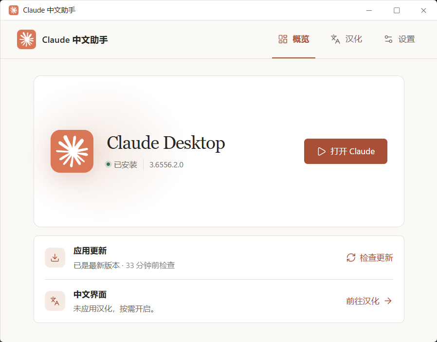

<div align="center">

# Claude 中文助手

**在 Windows 与 macOS 上管理官方 Claude Desktop，按需开启简体中文体验。**


[](LICENSE)

[下载助手](https://github.com/chrichuang218/claude-desktop-cn/releases/latest) · [界面预览](#界面预览) · [快速上手](#快速上手) · [反馈问题](https://github.com/chrichuang218/claude-desktop-cn/issues)

</div>

安装、更新、启动 Claude Desktop，以及应用或恢复汉化，都在一个小工具里完成。已有官方应用可以直接检测使用，汉化由你选择；通过助手更新 Claude 后，可按设置自动重新应用本地界面汉化。

> 本项目是第三方工具，与 Anthropic 没有从属关系。助手和 Claude Desktop 是两个独立应用，分别安装、更新和卸载。

> 仓库已更名为 `claude-desktop-cn`，v0.2.0 起仅使用新仓库更新源。0.1.x 用户请退出旧助手，用 v0.2.0 的 EXE 手动替换安装目录中的同名文件；原安装路径和配置继续保留。

> 提供 Windows 正式版和 **macOS 预览版**。Mac 双架构通过原生 CI 构建、自动测试和包内自检；真实 Claude 的安装、汉化恢复、权限和 Cowork 尚未完成交互验收。下方助手界面使用模拟状态展示，具体范围见 [macOS 验收清单](docs/macos-acceptance.md)。

## 界面预览

### 概览 · 版本、更新与启动，一目了然



### 汉化 · 本地中文界面与恢复

汉化页集中展示适用范围、补丁状态和操作按钮。只有本地界面汉化一个入口，可应用、重新应用或恢复原样；官方账号的中文设置另有说明。

### 设置 · 更新偏好与助手管理

设置页按“常规”“关于助手”和卸载区分组，提供自动检查更新、更新后重新汉化、快捷方式及助手更新入口。汉化页与设置页沿用概览的柔和暖色。

## 能做什么

- **管理官方应用**：检测已有 Claude Desktop，提供官方安装、更新与启动入口，下载包进行签名校验。
- **本地界面汉化**：为第三方 API 模式补充简体中文界面，保留 Cowork 兼容性；按需应用，也可恢复原样。
- **跟进上游汉化资源**：每次汉化或恢复前在线确认引擎修订，内容未变且缓存校验通过时直接复用，减少重复下载。
- **进度和日志可见**：执行过程中展示当前步骤、可用的下载进度与日志，失败时可复制日志排查。
- **按你的习惯安装**：助手支持便携、当前用户和系统安装；还可独立创建或修复 Claude Desktop 桌面快捷方式。
- **更新由你决定**：可在助手运行时每天检查 Claude 和助手的新版本，安装前由你确认。

## 汉化范围

助手仅提供 **本地界面汉化**，面向第三方 API 模式，翻译侧边栏、设置、模型选择等本地文本。官方账号界面已原生支持中文，可直接在 Claude 的语言设置中切换，无需安装此补丁。翻译覆盖与兼容性取决于 Claude 版本和上游汉化引擎，不能保证所有页面都能汉化。

旧版汉化记录和备份仍可用于恢复原样。重新应用或更新后自动汉化统一使用本地界面汉化。

## 快速上手

1. 前往 [最新 Release](https://github.com/chrichuang218/claude-desktop-cn/releases/latest)，按下表下载适合系统和芯片架构的包。macOS 附件为预览版；各包均配套同名 `.sha256` 摘要。
2. 启动助手，选择安装方式和位置。一般选 **用户安装**；**便携方式**默认在当前 EXE 或 `.app` 所在目录使用，不再复制程序。选择其他位置或用户/系统安装时，会保留原始下载文件；安装完成并退出后可删除原始文件，今后使用安装目录中的程序或快捷方式。macOS 用户安装默认为 `~/Applications`，系统安装默认为 `/Applications`，安装目录内的应用名称为 `Claude 中文助手.app`。
3. 在 **概览** 查看 Claude Desktop 状态。已安装则直接使用；未安装可通过助手下载安装。
4. 进入 **汉化**，点击 **应用汉化** 并确认。需要恢复时，点击 **恢复原样**。

更新、汉化和恢复可能关闭 Claude Desktop，请先保存正在进行的工作；出现系统权限提示时，按实际操作确认。

| 平台 | 下载 | 状态与运行环境 |
| --- | --- | --- |
| Windows x64 | [claude-windows-cn.exe](https://github.com/chrichuang218/claude-desktop-cn/releases/latest/download/claude-windows-cn.exe) | 正式版；Windows、WebView2 Runtime |
| macOS Apple Silicon | [claude-cn-macos-arm64.app.tar.gz](https://github.com/chrichuang218/claude-desktop-cn/releases/latest/download/claude-cn-macos-arm64.app.tar.gz) | 预览版；macOS 13+ |
| macOS Intel | [claude-cn-macos-x64.app.tar.gz](https://github.com/chrichuang218/claude-desktop-cn/releases/latest/download/claude-cn-macos-x64.app.tar.gz) | 预览版；macOS 13+ |

macOS 解压后运行 `Claude 中文助手.app`。预览包使用 ad-hoc 本地签名，没有 Apple Developer ID 签名与公证；Gatekeeper 可能阻止首次打开或要求用户在系统设置中批准。Windows 暂不提供 ARM64 版；Cowork 的硬件与系统要求以官方为准。下载安装、更新检查、汉化与恢复需要联网。

macOS 的汉化和恢复还需要 **Python 3.9 或更新版本**，可通过 [python.org](https://www.python.org/downloads/macos/) 或 Homebrew 安装。助手会检查依赖，缺少时明确提示，不会自动安装 Python；Claude 的安装、更新与启动不需要 Python。

当前版本的验证范围与已知限制见 [更新日志](CHANGELOG.md#025---2026-10-23)。

## 常见问题

### 更新 Claude 后会自动汉化吗？

取决于设置中的“更新后重新汉化”。该选项默认开启：通过助手更新 Claude 后，如果之前已应用汉化，会重新应用本地界面汉化；关闭后只提示汉化已被覆盖，按需手动重新应用。通过 Claude 自身或其他方式更新时，需回到助手查看实际状态。

### 提示“最新引擎缺少 Disable-FridaResidentForDiskInstall”怎么办？

升级到 **v0.2.5 或更新版本**。上游移除了旧 Frida 常驻功能和 Windows 的 `PatchMode` 参数，旧助手仍要求这些接口存在，因而在执行汉化前失败。新版已适配，清除缓存不能解决旧助手的接口不兼容。

原“完整汉化”入口已移除；官方账号请使用 Claude 自带的中文设置。已有汉化备份仍可用于“恢复原样”，无需删除数据目录。

### 恢复原样会删除聊天记录吗？

恢复针对当前 Claude 版本的原始应用文件，不删除个人数据。助手只使用能够验证、且属于当前版本的自有备份；缺少有效备份或发现其他工具的汉化资产时，会停止操作，不会强行覆盖。

### 卸载助手会卸载 Claude 吗？

不会。卸载助手只保留 Claude Desktop 本身及其个人数据：助手程序、它创建的入口（包括助手创建的 Claude Desktop 桌面快捷方式）和整个助手数据目录（设置、下载缓存、日志、汉化记录）会一并删除，完成后助手退出。

卸载不会恢复汉化，也不会改动 Claude 的安装目录。需要英文界面时，请先在助手里执行“恢复原样”再卸载；否则 Claude 会保持中文界面，直到下次官方更新或重新安装 Claude。在这种情况下再次安装助手，它会把残留的汉化视为其他来源，需要先重新安装 Claude。

### 已经用过其他汉化工具，可以直接接着用吗？

助手不自动迁移旧工具的配置、缓存或备份。若检测到其他来源的汉化资源，请先使用原工具恢复，再用本助手操作。

### 遇到问题如何反馈？

在执行页复制日志，通过 [Issues](https://github.com/chrichuang218/claude-desktop-cn/issues) 提供系统版本、芯片架构、Claude 版本、执行日志和复现步骤。发送前请检查日志中的用户名、路径等个人信息。

### Windows 提示“上次汉化未完成”怎么办？

新版在提权和目标权限检查通过后、开始运行汉化引擎前才写入未完成记录；取消 UAC 或权限准备失败后可直接重试。已经开始修改文件的失败仍会验证回滚，无法证明安全恢复时保留记录。

对于 v0.2.1 遗留的阻断，助手数据目录是 `%LOCALAPPDATA%\ClaudeWindowsCN`，不是程序安装目录 `%LOCALAPPDATA%\Programs\ClaudeWindowsCN`。先退出助手并保留 `patch-pending.json`、`patch-engine` 中对应操作的日志，以及 Claude 安装目录下 `app\resources\.zh-cn-backups` 中的备份。

仅当对应日志明确表明失败发生在 UAC 启动、包身份检查或取得/设置写权限阶段，且汉化引擎尚未执行时，才将 `patch-pending.json` 重命名为 `patch-pending.json.bak`，再启动新版重试。不能仅凭“没有备份目录”判断未修改文件；日志缺失或引擎已执行时，请提交日志核查，不要删除整个助手数据目录或原始文件备份。新版汉化页会显示实际记录和备份位置。

## 从源码运行

准备 Git、Node.js（20.19+ 的 20.x，或 22.12+）与 Rust。Windows 还需要 Microsoft C++ Build Tools 和 WebView2 Runtime；macOS 需要 Xcode Command Line Tools（`xcode-select --install`）。在对应系统执行：

```powershell
git clone https://github.com/chrichuang218/claude-desktop-cn.git
cd claude-desktop-cn
npm ci
npm run tauri dev
```

Windows 构建 EXE：

```powershell
npm run tauri build -- --no-bundle
```

产物：`src-tauri/target/release/claude-windows-cn.exe`。

macOS 构建应用（自动合并 `src-tauri/tauri.macos.conf.json`）：

```bash
APPLE_SIGNING_IDENTITY=- npm run tauri build -- --bundles app
```

产物：`src-tauri/target/release/bundle/macos/Claude 中文助手.app`。`--target aarch64-apple-darwin` 与 `--target x86_64-apple-darwin` 分别用于两个芯片架构，须先通过 `rustup target add` 安装目标。跨架构编译成功不能代替对应机器上的运行验收。

[CI 工作流](.github/workflows/ci.yml) 在 Windows、macOS Apple Silicon 和 macOS Intel runner 上执行检查、测试、打包、自检和摘要生成，并保存构建附件；不会自动创建 GitHub Release。

仅预览界面可运行 `npm run dev`；应用管理和汉化功能需要 Tauri 桌面程序。

<details>
<summary>开发检查命令</summary>

```powershell
npm run lint
npm run build
cargo fmt --check --manifest-path src-tauri/Cargo.toml
cargo test --manifest-path src-tauri/Cargo.toml
cargo check --manifest-path src-tauri/Cargo.toml
```

</details>

## 支持项目

如果这个小工具让你使用 Claude 更方便，欢迎点一个 **Star ⭐**，也欢迎通过 Issue 分享问题和建议。

想参与开发？请阅读 [贡献指南](CONTRIBUTING.md)。

## 致谢

🙏 感谢 [LINUX DO](https://linux.do/) 社区的支持与讨论。

感谢 [javaht/claude-desktop-zh-cn](https://github.com/javaht/claude-desktop-zh-cn)。本项目的汉化引擎与语言资源来自该项目。

## 来源与许可

官方应用管理能力参考 `claude-desktop-windows-updater`，助手更新校验流程参考 `codex-windows-cn`。相关上游代码、资源和商标遵循各自的许可与权利声明，详见 [第三方声明](THIRD_PARTY_NOTICES.md)。

本项目采用 [MIT 许可证](LICENSE)。「Claude」是 Anthropic 的商标。
